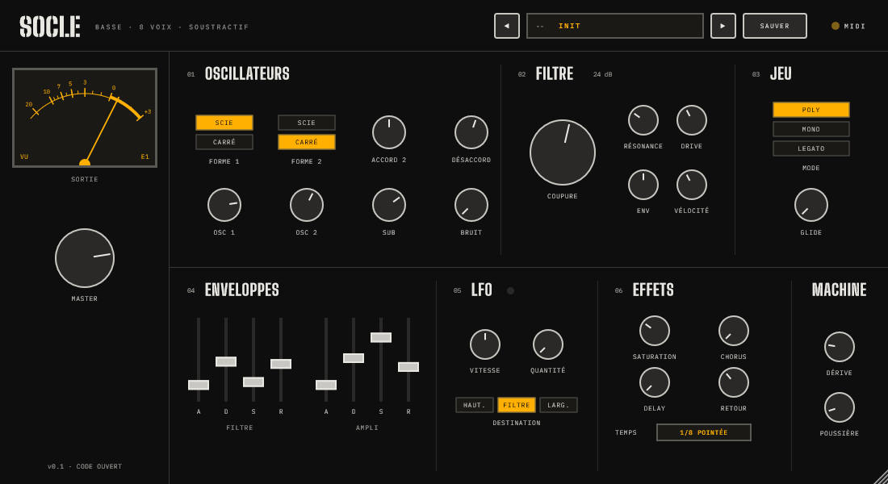

# SOCLE

**English** · [Français](README.fr.md)

A dirty, analog-style subtractive bass synthesizer plugin, the companion of
[MONOLITHE](https://github.com/damcoll/monolithe-vst).
Free and open source (AGPLv3). VST3 for Windows and macOS, AU for macOS.



Two oscillators and a sub into a Moog-style ladder filter, two envelopes, one LFO, built-in effects and
16 grimy factory presets. Every control is on the front panel: no menus, no modulation matrix.
SOCLE shares MONOLITHE's look and its MACHINE section, so the two sound like they came out of the same old box.

## Controls

**01 OSCILLATEURS**
- **FORME 1 / FORME 2** – sawtooth (SCIE) or square (CARRÉ) for each oscillator.
- **ACCORD 2** – tuning of oscillator 2, ±24 semitones. **DÉSACCORD** – fine detune of oscillator 2, ±50 cents.
- **OSC 1, OSC 2, SUB, BRUIT** – levels of the two oscillators, the sub (square, one octave down) and white noise.

**02 FILTRE** – 24 dB/octave transistor-ladder low-pass
- **COUPURE** – cutoff frequency, 30 Hz – 18 kHz. The filter follows the keyboard by half.
- **RÉSONANCE** – self-oscillates at the top of its range.
- **DRIVE** – pushes the filter input: it saturates rather than clips.
- **ENV** – how far the filter envelope opens the filter (up to 7 octaves).
- **VÉLOCITÉ** – how much velocity opens the filter and changes the level.

**03 JEU**
- **MODE** – **POLY** (8 voices), **MONO** (one voice, last note wins, every note restarts the envelopes) or
  **LEGATO** (one voice; notes played joined slide without a new attack).
- **GLIDE** – time to slide to the new note, 0 – 2 s. In POLY, each note slides from the last one played.

**04 ENVELOPPES** – two ADSR envelopes with analog-like curves: **FILTRE** (cutoff) and **AMPLI** (level).

**05 LFO** – a triangle shared by all voices; its light follows it.
- **VITESSE** – 0.05 – 20 Hz. **QUANTITÉ** – depth.
- **DESTINATION** – **HAUT.** (pitch: a vibrato, up to ±1 octave), **FILTRE** (±3 octaves, wobble) or
  **LARG.** (pulse width: only heard on square waves).

**06 EFFETS** – in this order, after the voices
- **SATURATION** – tube-like, warm then gritty. It makes the sound denser, not louder.
- **CHORUS** – Juno-style stereo chorus. The lows stay in the centre.
- **DELAY** – ping-pong echo synced to the DAW's tempo; the repeats get darker and thinner, like tape.
  **RETOUR** sets how many repeats, **TEMPS** the note value (1/16 to 1/2, dotted 1/8 by default).

**MACHINE** – the same as MONOLITHE's
- **DÉRIVE** (drift) – each voice slowly wanders out of tune, each note comes out a little different
  (tuning, brightness), the oscillators are free-running. 0 = perfectly steady.
- **POUSSIÈRE** (dust) – lo-fi: fewer bits, lower sample rate, darker tone, hiss and crackle. 0 = clean.

**Output** – **MASTER** level, with a soft saturation that keeps the output from clipping. The **VU meter**
follows the output and shows the last note played.

**MIDI** – pitch bend ±2 semitones, mod wheel (CC1) opens the filter.

Every control can be automated. Knobs and faders: drag or use the mouse wheel, double-click to reset.
The window can be resized from 75 % to 200 % (bottom-right corner).

## Presets

The screen at the top shows the current preset; ◀ ▶ step through the list, a click on the screen opens it.
A star (`ROUILLE *`) means the sound was changed since the preset was loaded.

**SAUVER** saves your sound under a name, as a readable `.socle` file in `Documents/SOCLE/Presets`
(copy them, share them). "Ouvrir le dossier des presets" in the list opens that folder.

| # | Preset | Sound |
|---|---|---|
| 01 | ROUILLE | Saw + square, detuned, medium drive: the all-round bass |
| 02 | BÉTON ARMÉ | Square + sub, closed filter, heavy saturation |
| 03 | CÂBLE NU | Acid: saw, high resonance, short envelope, mono with glide |
| 04 | GOUDRON | Dark and slow, legato, slow LFO on the filter |
| 05 | SOUS-SOL | Almost pure sub with noise and lots of dust: lo-fi dub |
| 06 | FONDERIE | Full drive and resonance: industrial growl |
| 07 | LIMAILLE | Metallic pulse-width modulation with chorus |
| 08 | FER BLANC | Thin plucked bass with a dotted echo |
| 09 | TURBINE | Wobble: fast LFO on the filter |
| 10 | HANGAR | Polyphonic, chorus and delay: bass chords |
| 11 | RIVET | Very short, percussive square |
| 12 | CHARBON | Reese: two saws far apart, lots of drift |
| 13 | SILO | Oscillator 2 an octave up: hollow |
| 14 | DÉCHARGE | Noise and maximum dust: broken |
| 15 | PYLÔNE | Mono, long glide, droning sub |
| 16 | BITUME | Slow attack that swells |

## Installation

Download the latest version from the [**Releases**](../../releases) page.

**Windows** – unzip and copy `SOCLE.vst3` into `C:\Program Files\Common Files\VST3\`
(create the folder if it does not exist; Windows will ask for administrator rights).

**macOS** – unzip and copy:
- `SOCLE.vst3` into `~/Library/Audio/Plug-Ins/VST3/`
- `SOCLE.component` (AU) into `~/Library/Audio/Plug-Ins/Components/`

The plugin is not signed by Apple. If macOS blocks it, open Terminal and run:

```
xattr -dr com.apple.quarantine ~/Library/Audio/Plug-Ins/VST3/SOCLE.vst3
xattr -dr com.apple.quarantine ~/Library/Audio/Plug-Ins/Components/SOCLE.component
```

> ⚠️ **The macOS version has not been tested on a real Mac yet.** It is built and checked automatically
> (pluginval and Apple's auval), but no one has played it in a DAW. Feedback is very welcome:
> please open an [issue](../../issues).

Then rescan your plugins in your DAW. SOCLE appears as an instrument (category *Synth*), next to MONOLITHE.

## Building from source

Requirements: CMake 3.22+, and Visual Studio 2022 (Windows) or Xcode (macOS).

```
git clone --recursive https://github.com/damcoll/socle-vst.git
cd socle-vst
cmake -B build
cmake --build build --config Release
```

The plugins are in `build/Socle_artefacts/Release/`. Two small tools are built as well:
- `SocleRender` – bass lines and every factory preset rendered to .wav, to tune the sound without a DAW;
- `SocleSnapshot` – a PNG of the plugin window.

The factory presets are the files in `presets/`; they are built into the plugin.

## License and credits

SOCLE is released under the **GNU AGPLv3**, see [LICENSE](LICENSE).

- Built with [JUCE](https://juce.com) (AGPLv3) and the Steinberg VST3 SDK (MIT).
- Typefaces: [Big Shoulders](https://github.com/xotypeco/big_shoulders) and [IBM Plex Mono](https://github.com/IBM/plex),
  under the SIL Open Font License (see `assets/fonts`).
- Plugins checked with [pluginval](https://github.com/Tracktion/pluginval) by Tracktion.
